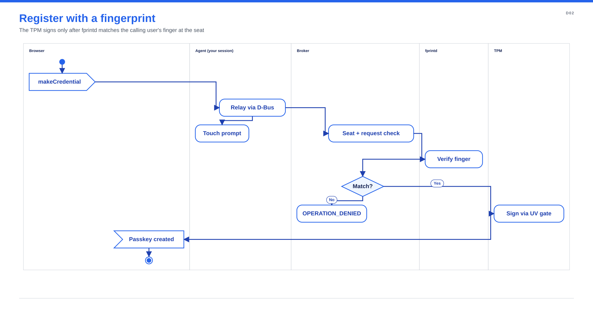
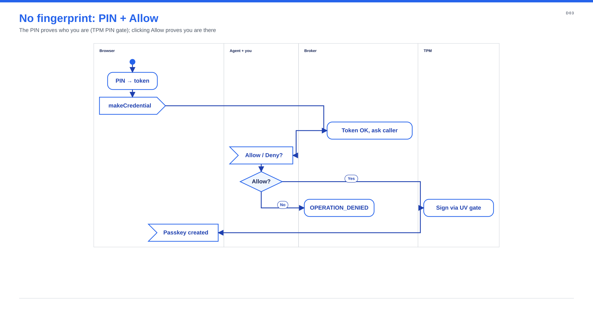
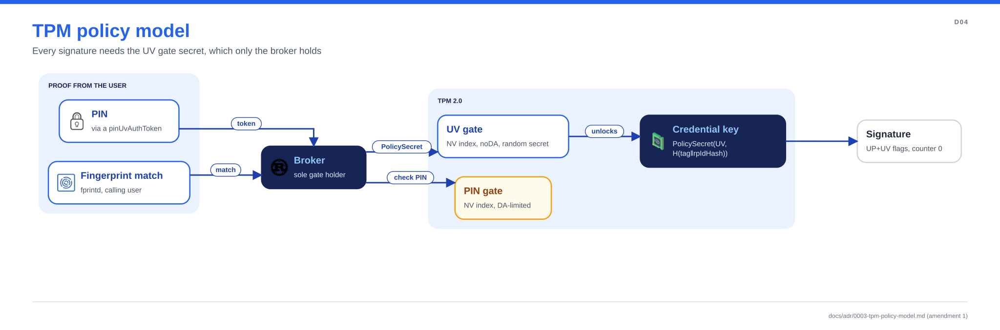

# How passkey-tpm works

The figures are generated from code in
[`docs/diagrams/src/`](https://github.com/dangerousplay/passkey-tpm/tree/main/docs/diagrams/src) with
[spinagram](https://github.com/dangerousplay/spinagram); run
[`docs/diagrams/render.sh`](https://github.com/dangerousplay/passkey-tpm/blob/main/docs/diagrams/render.sh)
after changing them.

## Components

Browsers and FIDO2 tools see an ordinary USB security key. `passkey-tpm-agent` creates it with
`/dev/uhid` in your session and forwards each CTAP request to the broker over the system bus.
The broker, `passkey-tpm-uvd`, runs as its own system user. It checks that you are the user in
front of the screen (logind), asks fprintd to match your finger, and is the only process that
can make the TPM sign. `passkey-tpm-tray` shows the status, enrolls fingerprints through fprintd
and sets the PIN through the broker. Everything in your session is untrusted: it can relay or
drop requests, but it can't sign without your finger or PIN.

## Registering with a fingerprint

The agent shows a "touch the reader" prompt, but the decision is the broker's. Only a
`verify-match` from fprintd, for the calling user and from the fprintd instance the broker
claimed, becomes user-verification evidence.

## Without a fingerprint: PIN and Allow

Users with no enrolled fingerprint verify with the security-key PIN, which the TPM checks
against a DA-limited PIN gate. Presence comes from an *Allow* click: the broker sends
`PresenceRequested` to the program that made the request and accepts `ConfirmPresence` only from
that same connection. This is weaker than a fingerprint touch; see the
[threat model](threat-model.md) and STATE AD-022.

## TPM policy

Each passkey is a TPM key whose policy is `PolicySecret` on the per-user UV gate, bound to the
relying party (`H(tag ‖ rpIdHash)`). Only the broker knows the UV gate secret, so a compromised
session or another user with TPM access can't sign. A PIN is checked against the PIN gate
first; the signature still goes through the UV gate. Details:
[ADR 0003](adr/0003-tpm-policy-model.md).
