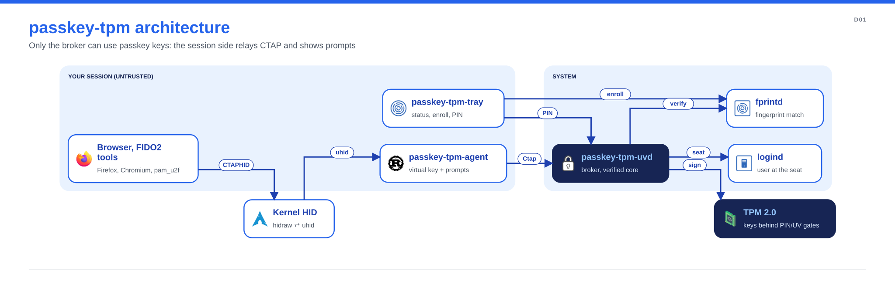

# passkey-tpm

Passkeys (FIDO2/WebAuthn) for Linux, stored in your computer's TPM 2.0 chip and unlocked with
your fingerprint, or with a PIN on machines without a reader. passkey-tpm appears to browsers
and other apps as a security key built into the computer: no USB key to carry, and the private
keys never leave the TPM.

!!! warning "Beta"
    It works end to end on test machines, but it hasn't had a security review and the on-disk
    format may still change. Keep a second way into important accounts.

## Get started

- **Install:** packages for Ubuntu/Debian, Fedora and Arch are on the
  [releases page](https://github.com/dangerousplay/passkey-tpm/releases); each one is signed
  with Sigstore and has build provenance.
- **Set up and use:** the [README](https://github.com/dangerousplay/passkey-tpm#readme) covers
  enabling the virtual key, the tray icon, websites, PINs, `pam_u2f` and LUKS.
- **Report a problem:** use the
  [issue forms](https://github.com/dangerousplay/passkey-tpm/issues/new/choose) and include the
  output of `passkey-tpm info`.

## Learn more

- [How it works](architecture.md): components, the fingerprint and PIN flows, the TPM policy.
- [Threat model](threat-model.md): what it protects against and its known limitations.
- Design decisions: [Rust and a verified core](adr/0001-rust-verified-core.md),
  [provider and uhid](adr/0002-provider-and-uhid.md),
  [TPM policy model](adr/0003-tpm-policy-model.md).
